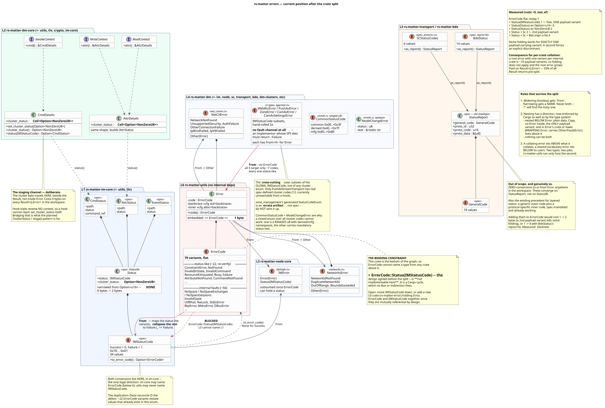
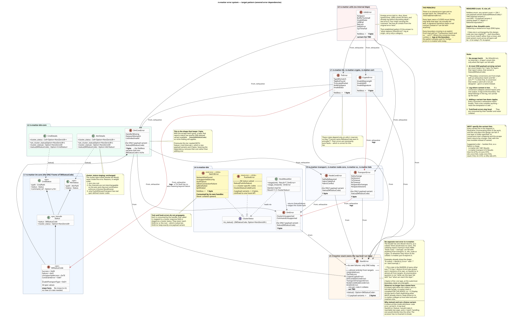

# Addressing issue [#192](https://github.com/project-chip/rs-matter/issues/192) - `ErrorCode` variants

This document describes the intended end goal for this work and the process of
getting there. Getting to the end goal will require a number of incremental PRs,
hence, if the work stops half way, this document shall help any future implementer
to finish this work.

Firstly, the current error systems relies on having one global errors used across
the system, mainly `ErrorCode` and `IMStatusCode` (see image below). While this is
cheap to implement it pollutes APIs and makes it difficult to distinguish errors.



Our target error system defines at least one error type per crate with clear boundaries
and explicit conversions between errors. Below is the final proposed design. Most errors
are handled close to where they happen, so few of these conversions are needed in the
end; see "Where errors are handled" below.



---

# Migration order

The per-crate process is:

1. Pick the next crate in the order below.
2. Create a crate-wide error type with the entries that crate needs — renaming
   where the current name is poor, splitting where one variant absorbs several
   distinguishable failures, adding what is missing.
3. `impl From<NewCrateError> for Error` **in the new crate**.
4. Replace internal uses of `Error`/`ErrorCode` with `NewCrateError`, including
   function signatures.
5. Fix dependents that break.
6. Test, PR.
7. Repeat.
8. When every crate is done, delete `Error` and `ErrorCode` from `rs-matter-utils`.

**Open, to settle before the `im-core` step:** how an error is traced back to
where it happened on targets without `backtrace`, and where it is logged. See
"Tracing an error back to where it happened" below.

**TODO**: Once this work is complete, replace this documentation with descriptions of
the latest design, usages and conventions for future work to follow.


## Why this order

It is the **topological order of the crate graph**, cheapest-ready-first within
each tier. That is not an aesthetic preference — it is what avoids throwaway work.

Convert a crate *before* its dependencies and its internals still receive the
shared `Error` from below, so it needs `impl From<Error> for NewCrateError`: a
collapse of all ~79 `ErrorCode` variants onto that crate's set. Lossy, large, and
deleted later.

Convert in dependency order and every incoming conversion is from a crate that has
**already** been converted, so it is small, exhaustive, and **the conversion the
final design keeps**. No shim is thrown away.

Two consequences worth stating:

- **`rs-matter-utils` goes first.** It has no internal dependencies, so
  it is the only crate needing no incoming conversion at all. `Error` and
  `ErrorCode` stay in `utils` alongside its new error types until step 8 — everything
  above keeps compiling against them until its own turn comes.
- **Step 5 is cheaper than the dependent count suggests.** With
  `From<NewCrateError> for Error` in place, a dependent doing `foo()?` into its own
  `Result<_, Error>` still compiles. Only sites that *name* the error type break —
  explicit annotations, `match` arms, errors stored in a field.

## The order

`macros` and `codegen` are **not** separate steps, despite having no dependencies
of their own. They emit code into other crates, so each is merged into the step for
the crate whose signatures its templates must satisfy — see Special cases below.

| # | crate / unit | distinct vars | `ErrorCode` mentions | `pub fn` | `pub(crate) fn` | notes |
|---|---|---|---|---|---|---|
| 1 | `utils` | 13 | 34 | 35 | 0 | no incoming conversion — the only such crate |
| 2 | **`tlv` + `macros`** *(Unit A)* | 5 | 77 | 67 | 1 | **+ the `ToTLV`/`FromTLV` trait signatures** |
| 3 | `crypto` | 4 | 37 | 7 | 0 |  |
| 4 | `pairing` | 4 | 30 | 10 | 0 |  |
| 5 | `cert` | 16 | 98 | 36 | 0 |  |
| 6 | `im-core` | 24 | 59 | 140 | 0 | widest boundary; `Status(IMStatusCode)` becomes available |
| 7 | **`dm-core` + `codegen`** *(Unit B)* | 12 | 49 | 30 | 0 | **`dm-clusters` recompiles as the check** |
| 8 | `node-core` | 21 | 74 | 67 | 0 |  |
| 9 | `transport` | 21 | 167 | 116 | 19 |  |
| 10 | `bdx` | 4 | 8 | 22 | 7 |  |
| 11 | `sc` | 13 | 62 | 42 | 0 |  |
| 12 | `node` | 6 | 9 | 18 | 0 |  |
| 13 | `onboard` | 6 | 16 | 8 | 4 |  |
| 14 | `im` | 7 | 23 | 19 | 7 |  |
| 15 | `respond` | 0 | 0 | 4 | 0 | free — no `ErrorCode` usage |
| 16 | `dm` | 31 | 624 | 58 | 4 | largest single step; only 2 dependents |
| 17 | `stack` | 1 | 2 | 12 | 0 | **`StackError` is built here** — the collator |
| 18 | `rs-matter` | 0 | 0 | 0 | 0 | free — re-exports `StackError` |

`pub fn` and `pub(crate) fn` count functions returning `Result<_, Error>`; those are
the signatures step 4 changes. Comments and `#[cfg(test)]` items are excluded
throughout. Unit rows sum their members and de-duplicate the variant set.

## Special cases

**Zero-work crates — only two.** `respond` (a thin dispatcher) and `rs-matter` (a
121-line facade) have no `ErrorCode` usage. Skip them in steps 2–4.

`dm-clusters` is *not* free, despite showing zero mentions: its source is generated,
and the generated output carries `ErrorCode` paths via `codegen`'s 25 template
mentions. The work is in the generator.

**The two generators must move with the crates they emit into.** `macros` and
`codegen` are not ordinary crates — their `ErrorCode` mentions sit inside `quote!`
templates describing code emitted elsewhere. They pair differently:

**Unit A — `macros` + `tlv` + the TLV trait signatures.** `rs-matter-macros` is
depended on by `rs-matter-tlv` alone. Three things must change together or nothing
compiles:

- the trait signatures, `traits.rs:50` `from_tlv(..) -> Result<Self, Error>` and
  `traits.rs:94` `to_tlv(..) -> Result<(), Error>`
- the macro templates, which emit *against* those signatures — e.g.
  `nullable_to_tlv` currently writes both the return type
  `Result<(), #krate::__private::Error>` and the body
  `Err(#krate::__private::ErrorCode::ConstraintError.into())`
- `tlv`'s own internals

Once the signature is `Result<(), TlvError>` the template body becomes
`Err(TlvError::ConstraintError)` — the `.into()` disappears.

**Unit B — `codegen` + `dm-core` + `dm-clusters`.** `rs-matter-codegen` is depended
on by `rs-matter-dm-clusters` alone, and is run from its `build.rs` into `OUT_DIR`.
Its templates emit cluster *handler* impls, so the error type they must name is
fixed by `dm-core`'s handler trait signatures — not by TLV. They are one step,
#7 in the order.

**The derive ripple is one impl, not thirteen.** Changing the TLV trait error type
touches derive-generated code in 13 crates — `im-core` (9 derive files, 40 call
sites), `dm` (16/20), `tlv` (4/31), `sc` (4/11), `codegen` (2/13), `dm-core` (2/6),
`im` (1/8), `node-core` (5/4) and five more. But every unconverted consumer still
returns `Error`, so a single `impl From<TlvError> for Error` in `tlv` keeps all of
them compiling through `?`. Each consumer gets its own conversion later, on its own
turn. The same holds for unit B.

**`im-core` has the widest boundary**: 140 `pub fn` returning `Result<_, Error>`,
against 59 mentions and 24 distinct variants. The vocabulary is modest; the
signature churn is not. It is also the home of `IMStatusCode`, so this is where
`Status(IMStatusCode)` first becomes available as a payload variant.

**`dm` is the largest single step**: 624 mentions, 31 distinct variants, 62
signatures — but only 2 dependents (`rs-matter`, `stack`), so it ripples almost
nowhere. It lands at #16 because it depends on nearly everything.

## Naming and conversion convention

Variant *names* are crate-local and constrain nobody: the only cross-crate
obligations are the `From` impls and, where relevant, the conversion to
`IMStatusCode`. Nothing `dm` calls its variants affects what `cert` or `tlv` call
theirs, and there is no failure mode available to `dm` that is not also available
to `crypto` — it is simply larger.

What *can* drift is **collapse granularity**. A conversion may legitimately map
several source variants onto one target, logging at the boundary. But if
`node-core` collapses `TlvError`'s five variants into one while `transport` keeps
them distinct, the same underlying failure reaches the top with different detail
depending on the route it took. That is not a correctness problem — the boundary
log preserves the detail either way — but it is the kind of inconsistency that gets
re-litigated in every PR unless a rule is agreed first.

The rule is: **collapse at the layer where the distinction stops being
actionable.** If a caller could plausibly branch on the difference, keep it; if no
caller could, collapse it and log.

With `alloc` and `backtrace`, a conversion keeps the error it converts as the
source of the new one (`new_with_details`): the new error captures its own
backtrace, and `Debug` prints its code and backtrace, then those of the source.
The bridge from `Error2` to `Error` does this, and a conversion between two
`Error2` types should do the same. When backtraces are disabled at run time (e.g.
`RUST_BACKTRACE` is not set) and the error has no source of its own, it is not
kept, as it would add only its code at the cost of an allocation. Without these
features, only the code is converted.

A code says what happened, not who caused it. A crate often cannot tell
whether an input came from the peer, from storage or from the node's own code;
the caller can, and it decides how to answer.

A failure that is impossible unless the code is wrong, e.g. on a length fixed by
a type or a constant, gets no code: it is an `unwrap!`. Never panic on data that
comes from storage or that a peer can reach: a wrong guess becomes a boot loop
or a remote reboot.

Each crate defines its error with `error_type!` from `rs-matter-utils`: a newtype
over `Error2` with the crate's code. The orphan rule forbids
`impl From<OtherError> for ItsError` when both are `Error2` types, but allows it
for the newtype. So a crate implements `From` for the errors of the crates below
it, and `?` converts them. The `From` uses `Error2::convert`, which, with `alloc`
and `backtrace`, keeps the converted error as the source:

```rust
rs_matter_utils::error_type!(
    /// The error of `rs-matter-cert`.
    pub CertError, CertErrorCode
);

impl From<TlvError> for CertError {
    fn from(err: TlvError) -> Self {
        let code = err.code().into();
        err.convert(code).into()
    }
}
```

The newtype dereferences to the `Error2`, e.g. for its `details` and `backtrace`.

## Where errors are handled

A `From` conversion is needed only where an error is passed up into a crate with a
different error type. The aim is to need few of them:

- An error is handled by the first caller that can turn it into something for the
  peer. Until then it is passed up unchanged.
- An error that corresponds to an IM status is handled inside `rs-matter-im` and
  written into the reply. A request that cannot be parsed is answered with a Status
  Response carrying `INVALID_ACTION`, and the interaction ends. Data that cannot be
  decoded inside an otherwise valid request is answered per path:
  `INVALID_COMMAND` for a command field, `CONSTRAINT_ERROR` for an attribute value
  outside its constraints.
- `InteractionModel::handle` returns only the errors of the `Exchange` itself: a
  send or receive that failed, a timeout, a session that is gone.

The Matter spec asks for this, and the CHIP SDK works this way: its
`InteractionModelEngine::OnMessageReceived` turns the status of each request
handler into a Status Response, and returns only the error of sending it. In
rs-matter today, a TLV error while parsing a request (e.g. in `req.inv_requests()?`)
is still returned from `handle` as an error, and the exchange is dropped without a
reply.

With errors handled this way, the one large boundary left is from `TlvError` to the
error of the cluster handlers in `rs-matter-dm-core`. The generated cluster code and
the handlers cross it at a great many `?`, so this conversion should compile to
nothing: either the handler error embeds `TlvErrorCode`, or its codes have the same
numeric values as the `TlvErrorCode` ones. The bridge from `TlvErrorCode` to the
legacy `ErrorCode` already works like that.

## Tracing an error back to where it happened (an idea, not implemented)

With `alloc` and `backtrace`, a converted error keeps the original as its source,
so `Debug` shows where each error in the chain happened. Without them, as on most
embedded targets, a conversion keeps only the new code. A log then shows e.g. that
a certificate was rejected with `InvalidFormat`, but not which TLV read failed.
Three things pull against each other: the information, the flash it costs, and
logs that stay readable.

What others do:

- OpenThread passes errors up as plain codes (`SuccessOrExit`, about 1,850 uses in
  its core) without logging them, and logs once where an error is handled
  (`LogWarnOnError(error, "send petition response")`, about 50 uses).
- CHIP does the same by default. With `CHIP_CONFIG_ERROR_SOURCE`, which is off by
  default, every `CHIP_ERROR` also carries the file and line where it was
  created, and its `LogErrorOnFailure` macros print them.

### Recording where an error happened

A cargo feature, e.g. `error-location`, makes `Error2` hold a
`&'static core::panic::Location`. It is set with `#[track_caller]` on
`Error2::new`, on the `From` of a code, and on the `From` impls between the
crates. A `#[track_caller]` `From::from` sees the `?` that calls it, so the
recorded place is the line of that `?`. `convert` keeps the location of the error
it converts, so the location is the place where the error first happened.

Recording writes no log line. It costs 4 bytes per error value on 32-bit targets,
16 bytes of `.rodata` for every place that creates or converts an error, and the
file names. That is why it is a feature, off by default.

### Is one location enough?

Maybe not. The location of a generic error is often in generic code: a
`TlvError` would point at a line in `rs-matter-tlv`'s `read.rs`, which does not
say whether the certificate code or the IM was reading. Three ways to get more,
none of which adds log lines:

- `#[track_caller]` on the public fallible functions of the low-level crates,
  e.g. the TLV accessors and `WriteBuf`/`ReadBuf`, only with `error-location`. The
  recorded location is then the line that called them, e.g. in `rs-matter-cert`.
  Without the feature they stay as they are, since `#[track_caller]` passes a
  hidden argument at every call.
- A short chain of locations rather than one: where the error was created, and
  each conversion after it, e.g. up to four. The handler's line then shows the
  path of the error through the crates, like a small backtrace. Each slot costs 4
  bytes in every error value, and so in every `Result` and future that holds one.
- A `debug!` at each conversion, as a verbose mode that is filtered per module,
  e.g. `DEFMT_LOG=rs_matter_cert=debug`, for when someone chases one problem.

This is worth settling soon: every crate step adds `From` impls between the
errors. If they come from a macro in `rs-matter-utils`, e.g.
`error_from!(TlvError => CertError, ..)`, rather than being written by hand, the
`#[track_caller]` and the recording can be added in one place, chosen by the
features of `rs-matter-utils` like the `defmt` impl of `error_type!`. The
`im-core` and `dm-core` steps add the most of these conversions, so before them.

### Where to log

An error is logged once, where it is handled: where it ends as a status, a
dropped message or a failed step. Turning on `error-location` then adds the
origin to those lines, and never adds lines of its own. The places:

1. The responder loop, when it abandons an exchange (`respond_once`).
2. The IM, where an error becomes a status.
3. CASE and PASE, where a handshake fails.
4. The transport, where it drops a message.
5. A background task that gives up or retries, e.g. persisting or reporting.
6. The commissioner, where a step fails.

The level depends on who caused the failure:

- The node itself, e.g. `NoMemory`, `BufferTooSmall` or a bug: `warn!` or
  `error!`. It is rare, and it needs fixing.
- A peer: `warn!` once when it ends a handshake or a commissioning, which is rare
  and matters when two products do not work together. `debug!` for each failed
  path of a request and for each dropped message, as a peer decides how often
  these happen.
- An ordinary outcome, e.g. `NoSpace` when a report is split into chunks, the end
  of a list, a lookup that finds nothing, or `Busy`: no log.

Never at each `?`, at each conversion between the crates' errors, or for each item
of a request.

One more kind of place logs on its own: a conversion that drops information that
the error cannot carry, e.g. an mbedtls, openssl, `der` or I/O error mapped to a
code. There, a `debug!` with the original error. With `defmt`, the format string
costs no flash, and the file and line come from the debug info
(`defmt-print --show-location`). Below the `debug` level it compiles to nothing.

Today's code differs from this in a few places, to be changed when the crates are
converted: the IM invoker logs every failed path with `error!`, also for ordinary
answers such as an unsupported attribute; the transport logs every dropped message
with `error!`; and the crypto backends log input that a peer can send with
`error!`.

## A note for the `dm-core` step: not every error is a status

When `rs-matter-dm-core` gets its own error, the obvious shape for it is the set
of Matter status codes - a cluster handler fails, and that failure becomes a
status field in the response. Mostly that is right.

There is one case where it is not, and it is easy to miss because the wrong
version still compiles.

`TlvErrorCode::NoSpace` means "the TLV writer ran out of room". It is not a
failure to report to the peer - it is a signal that the response must be split
into chunks and continued in the next message. The interaction model acts on it
in `rs-matter-im/src/invoker.rs`:

```rust
let result = self.read(attr, &mut *tw).await;   // calls the cluster handler

match result {
    Ok(()) => Ok(None),
    Err(e) if e.code() != ErrorCode::NoSpace => {
        tw.rewind_to(pos);
        Ok(attr.status(e.into()))               // a real failure -> status
    }
    Err(e) => Err(e),                           // out of room -> chunk and retry
}
```

The handler's error type therefore carries two different kinds of thing: real
failures, which become a status, and "the buffer filled up", which has to pass
through untouched.

If the handler's error were exactly the status-code set, `NoSpace` would have to
be mapped to *some* status, and this code could no longer tell the two apart. It
would write a status where it should have chunked - and both branches typecheck,
so nothing would complain. Long reads would quietly return a truncated response.

So the handler error needs either a variant that is not a status, or a separate
way to carry this one signal. Worth settling before the `dm-core` step rather
than after.

A related constraint, for the same step: the TLV builder's closure-taking methods
(`TLVBuilder::with_some`, `with_non_null`, `TLVWrite::str_cb`, and friends) are
generic over the caller's error with a `From<TlvError>` bound, because their
bodies do TLV work of their own. Cluster handlers pass closures to them, so
whatever `dm-core` ends up with has to implement `From<TlvError>`.

---

# Appendix A - ErrorCode / IMStatusCode usage by crate (production code only)

These counts are from before the `tlv` step and are not updated as the crates are
converted.

Generated from source. Counts qualified-path mentions (`ErrorCode::X`, `IMStatusCode::X`) in each crate's `src/`, with **line comments and every `#[cfg(test)]` item removed**, and the `tests/` and `examples/` workspace members excluded. Blank cells are zero.

Rows are sorted by **number of crates** that use the variant, then by total mentions — so the variants at the top are the ones hardest to confine to a single layer, and those at the bottom are the easiest.

Caveat: `codegen` and `macros` mentions are inside `quote!` templates. They describe code emitted into the generated cluster handlers, not those crates' own error handling.

## ErrorCode (79 variants)

| variant | bdx | cert | codegen | crypto | dm | dm-core | im | im-core | macros | node | node-core | onboard | pairing | sc | stack | tlv | transport | utils | TOT | crates |
|---|---|---|---|---|---|---|---|---|---|---|---|---|---|---|---|---|---|---|---|---|
| `InvalidData` |  | 36 | 4 | 31 | 31 |  |  | 3 |  | 1 | 6 | 4 | 20 | 15 |  | 16 | 22 | 3 | **192** | 13 |
| `Invalid` | 4 | 17 |  |  | 23 | 1 | 5 | 8 | 3 |  | 4 |  |  | 22 |  | 5 | 30 | 3 | **125** | 12 |
| `BufferTooSmall` |  | 4 |  | 3 | 2 | 2 |  |  |  | 2 | 5 | 2 | 7 | 2 |  |  | 3 | 4 | **36** | 11 |
| `ConstraintError` |  |  |  | 2 | 266 | 4 | 1 | 2 | 3 |  | 6 |  |  | 1 |  | 17 |  |  | **302** | 9 |
| `NotFound` |  | 6 |  |  | 38 |  |  | 2 |  |  | 8 | 1 | 2 | 2 |  | 1 | 5 |  | **65** | 9 |
| `InvalidAction` |  |  | 1 |  | 43 | 1 | 5 | 2 |  |  | 3 |  |  |  | 2 |  |  |  | **57** | 7 |
| `Failure` |  |  | 1 |  | 17 |  |  | 7 |  |  | 1 | 6 |  |  |  |  | 3 |  | **35** | 6 |
| `NoSpace` |  |  |  | 1 | 9 |  | 7 |  |  |  |  |  | 1 |  |  |  | 4 | 6 | **28** | 6 |
| `Busy` |  |  |  |  | 2 |  |  | 2 |  | 1 | 2 | 1 |  | 2 |  |  |  |  | **10** | 6 |
| `ResourceExhausted` |  |  |  |  | 47 |  | 2 | 2 |  |  | 17 |  |  |  |  |  | 9 |  | **77** | 5 |
| `InvalidCommand` |  |  |  |  | 43 |  |  | 2 |  |  | 4 |  |  | 2 |  |  |  |  | **51** | 4 |
| `AttributeNotFound` |  |  | 11 |  | 26 | 4 |  | 2 |  |  |  |  |  |  |  |  |  |  | **43** | 4 |
| `CommandNotFound` |  |  | 6 |  | 24 | 3 |  | 2 |  |  |  |  |  |  |  |  |  |  | **35** | 4 |
| `NoSession` |  |  |  |  |  |  |  |  |  | 1 |  | 2 |  | 4 |  |  | 14 |  | **21** | 4 |
| `InvalidState` |  |  |  |  | 4 |  |  |  |  |  | 1 |  |  | 1 |  |  | 10 |  | **16** | 4 |
| `InvalidOpcode` | 1 |  |  |  |  |  | 1 |  |  |  |  |  |  | 7 |  |  | 5 |  | **14** | 4 |
| `FailSafeRequired` |  |  |  |  | 1 |  |  | 2 |  | 1 | 2 |  |  |  |  |  |  |  | **6** | 4 |
| `NoNetworkInterface` |  |  |  |  | 6 |  |  |  |  |  |  |  |  | 1 |  |  | 20 |  | **27** | 3 |
| `UnsupportedAccess` |  |  |  |  | 14 |  |  | 2 |  |  | 1 |  |  |  |  |  |  |  | **17** | 3 |
| `EndpointNotFound` |  |  |  |  | 2 | 6 |  | 2 |  |  |  |  |  |  |  |  |  |  | **10** | 3 |
| `EventNotFound` |  |  | 2 |  |  | 1 |  | 2 |  |  |  |  |  |  |  |  |  |  | **5** | 3 |
| `InvalidProto` | 1 |  |  |  |  |  | 2 |  |  |  |  |  |  | 2 |  |  |  |  | **5** | 3 |
| `TLVTypeMismatch` |  |  |  |  |  |  |  |  | 2 |  |  |  |  |  |  | 30 |  |  | **32** | 2 |
| `TxTimeout` |  |  |  |  |  |  |  |  |  |  |  |  |  |  |  |  | 12 | 1 | **13** | 2 |
| `InvalidInState` |  |  |  |  | 7 |  |  | 2 |  |  |  |  |  |  |  |  |  |  | **9** | 2 |
| `GennCommInvalidAuthentication` |  |  |  |  | 3 |  |  |  |  |  | 4 |  |  |  |  |  |  |  | **7** | 2 |
| `BtpError` |  |  |  |  |  |  |  |  |  |  |  |  |  |  |  |  | 4 | 2 | **6** | 2 |
| `TruncatedPacket` | 2 |  |  |  |  |  |  |  |  |  |  |  |  |  |  |  |  | 3 | **5** | 2 |
| `InvalidDataType` |  |  |  |  | 2 |  |  | 2 |  |  |  |  |  |  |  |  |  |  | **4** | 2 |
| `InvalidSignature` |  | 2 |  |  |  |  |  |  |  |  |  |  |  |  |  |  | 2 |  | **4** | 2 |
| `NocInvalidFabricIndex` |  |  |  |  | 3 |  |  |  |  |  | 1 |  |  |  |  |  |  |  | **4** | 2 |
| `ClusterNotFound` |  |  |  |  |  | 1 |  | 2 |  |  |  |  |  |  |  |  |  |  | **3** | 2 |
| `DataVersionMismatch` |  |  |  |  |  | 1 |  | 2 |  |  |  |  |  |  |  |  |  |  | **3** | 2 |
| `DynamicConstraintError` |  |  |  |  | 1 |  |  | 2 |  |  |  |  |  |  |  |  |  |  | **3** | 2 |
| `NocFabricConflict` |  |  |  |  | 1 |  |  |  |  |  | 2 |  |  |  |  |  |  |  | **3** | 2 |
| `NocInvalidNoc` |  |  |  |  | 1 |  |  |  |  |  | 2 |  |  |  |  |  |  |  | **3** | 2 |
| `NocInvalidPublicKey` |  |  |  |  | 1 |  |  |  |  |  | 2 |  |  |  |  |  |  |  | **3** | 2 |
| `StdIoError` |  | 1 |  |  |  |  |  |  |  |  |  |  |  |  |  |  |  | 2 | **3** | 2 |
| `AlreadyExists` |  |  |  |  | 1 |  |  | 1 |  |  |  |  |  |  |  |  |  |  | **2** | 2 |
| `NocFabricTableFull` |  |  |  |  | 1 |  |  |  |  |  | 1 |  |  |  |  |  |  |  | **2** | 2 |
| `NocInvalidAdminSubject` |  |  |  |  | 1 |  |  |  |  |  | 1 |  |  |  |  |  |  |  | **2** | 2 |
| `NocMissingCsr` |  |  |  |  | 1 |  |  |  |  |  | 1 |  |  |  |  |  |  |  | **2** | 2 |
| `RxTimeout` |  |  |  |  |  |  |  |  |  |  |  |  |  |  |  |  | 1 | 1 | **2** | 2 |
| `CdInvalidFormat` |  | 12 |  |  |  |  |  |  |  |  |  |  |  |  |  |  |  |  | **12** | 1 |
| `DBusError` |  |  |  |  |  |  |  |  |  |  |  |  |  |  |  |  |  | 6 | **6** | 1 |
| `NoSpaceSessions` |  |  |  |  |  |  |  |  |  |  |  |  |  |  |  |  | 6 |  | **6** | 1 |
| `CdInvalidProductId` |  | 5 |  |  |  |  |  |  |  |  |  |  |  |  |  |  |  |  | **5** | 1 |
| `CdInvalidVendorId` |  | 5 |  |  |  |  |  |  |  |  |  |  |  |  |  |  |  |  | **5** | 1 |
| `Duplicate` |  |  |  |  |  |  |  |  |  |  |  |  |  |  |  |  | 5 |  | **5** | 1 |
| `MdnsError` |  |  |  |  |  |  |  |  |  |  |  |  |  |  |  |  | 5 |  | **5** | 1 |
| `CdSigningKeyNotFound` |  | 3 |  |  |  |  |  |  |  |  |  |  |  |  |  |  |  |  | **3** | 1 |
| `NoExchange` |  |  |  |  |  |  |  |  |  |  |  |  |  |  |  |  | 3 |  | **3** | 1 |
| `NoMemory` |  |  |  |  |  |  |  |  |  | 3 |  |  |  |  |  |  |  |  | **3** | 1 |
| `NoSpaceExchanges` |  |  |  |  |  |  |  |  |  |  |  |  |  |  |  |  | 3 |  | **3** | 1 |
| `InvalidTime` |  | 2 |  |  |  |  |  |  |  |  |  |  |  |  |  |  |  |  | **2** | 1 |
| `InvalidTransportType` |  |  |  |  |  |  |  | 2 |  |  |  |  |  |  |  |  |  |  | **2** | 1 |
| `NeedsTimedInteraction` |  |  |  |  |  |  |  | 2 |  |  |  |  |  |  |  |  |  |  | **2** | 1 |
| `NocLabelConflict` |  |  |  |  | 2 |  |  |  |  |  |  |  |  |  |  |  |  |  | **2** | 1 |
| `NodeNotFound` |  |  |  |  |  |  |  | 2 |  |  |  |  |  |  |  |  |  |  | **2** | 1 |
| `CdInvalidPaa` |  | 1 |  |  |  |  |  |  |  |  |  |  |  |  |  |  |  |  | **1** | 1 |
| `CdInvalidSignature` |  | 1 |  |  |  |  |  |  |  |  |  |  |  |  |  |  |  |  | **1** | 1 |
| `InvalidArgument` |  |  |  |  |  |  |  |  |  |  |  |  |  |  |  |  | 1 |  | **1** | 1 |
| `InvalidAuthKey` |  | 1 |  |  |  |  |  |  |  |  |  |  |  |  |  |  |  |  | **1** | 1 |
| `NoFabricId` |  | 1 |  |  |  |  |  |  |  |  |  |  |  |  |  |  |  |  | **1** | 1 |
| `NoNodeId` |  | 1 |  |  |  |  |  |  |  |  |  |  |  |  |  |  |  |  | **1** | 1 |
| `NoSharedTrustRoots` |  |  |  |  |  |  |  |  |  |  |  |  |  | 1 |  |  |  |  | **1** | 1 |
| `RwLock` |  |  |  |  |  |  |  |  |  |  |  |  |  |  |  |  |  | 1 | **1** | 1 |
| `SysTimeFail` |  |  |  |  |  |  |  |  |  |  |  |  |  |  |  |  |  | 1 | **1** | 1 |
| `Utf8Fail` |  |  |  |  |  |  |  |  |  |  |  |  |  |  |  |  |  | 1 | **1** | 1 |
| `AttributeIsCustom` |  |  |  |  |  |  |  |  |  |  |  |  |  |  |  |  |  |  | **0** |  |
| `InvalidAAD` |  |  |  |  |  |  |  |  |  |  |  |  |  |  |  |  |  |  | **0** |  |
| `InvalidKeyLength` |  |  |  |  |  |  |  |  |  |  |  |  |  |  |  |  |  |  | **0** |  |
| `InvalidPeerAddr` |  |  |  |  |  |  |  |  |  |  |  |  |  |  |  |  |  |  | **0** |  |
| `NoCommand` |  |  |  |  |  |  |  |  |  |  |  |  |  |  |  |  |  |  | **0** |  |
| `NoEndpoint` |  |  |  |  |  |  |  |  |  |  |  |  |  |  |  |  |  |  | **0** |  |
| `NoHandler` |  |  |  |  |  |  |  |  |  |  |  |  |  |  |  |  |  |  | **0** |  |
| `NoTagFound` |  |  |  |  |  |  |  |  |  |  |  |  |  |  |  |  |  |  | **0** |  |
| `PacketPoolExhaust` |  |  |  |  |  |  |  |  |  |  |  |  |  |  |  |  |  |  | **0** |  |
| `TLVNotFound` |  |  |  |  |  |  |  |  |  |  |  |  |  |  |  |  |  |  | **0** |  |
| **TOTAL** | **8** | **98** | **25** | **37** | **623** | **24** | **23** | **59** | **8** | **9** | **74** | **16** | **30** | **62** | **2** | **69** | **167** | **34** | | |

### Unused in production code (10)

Candidates for deletion — referenced only in tests, comments, or not at all.

`AttributeIsCustom`, `InvalidAAD`, `InvalidKeyLength`, `InvalidPeerAddr`, `NoCommand`, `NoEndpoint`, `NoHandler`, `NoTagFound`, `PacketPoolExhaust`, `TLVNotFound`

## IMStatusCode (35 variants)

| variant | dm | dm-core | im | im-core | transport | TOT | crates |
|---|---|---|---|---|---|---|---|
| `Success` | 5 |  | 5 | 4 | 7 | **21** | 4 |
| `UnsupportedAccess` | 1 | 2 | 4 | 1 |  | **8** | 4 |
| `UnsupportedAttribute` |  | 2 | 3 | 1 |  | **6** | 3 |
| `UnsupportedCluster` |  | 2 | 3 | 1 |  | **6** | 3 |
| `UnsupportedEndpoint` |  | 2 | 2 | 1 |  | **5** | 3 |
| `Failure` |  |  | 1 | 2 | 1 | **4** | 3 |
| `UnsupportedCommand` |  | 2 | 1 | 1 |  | **4** | 3 |
| `ResourceExhausted` | 1 |  | 1 | 1 |  | **3** | 3 |
| `InvalidAction` |  |  | 5 | 1 |  | **6** | 2 |
| `ConstraintError` | 3 |  |  | 1 |  | **4** | 2 |
| `Busy` |  |  | 2 | 1 |  | **3** | 2 |
| `NeedsTimedInteraction` |  |  | 2 | 1 |  | **3** | 2 |
| `NotFound` | 2 |  |  | 1 |  | **3** | 2 |
| `UnsupportedEvent` |  |  | 2 | 1 |  | **3** | 2 |
| `UnsupportedNode` |  |  | 2 | 1 |  | **3** | 2 |
| `UnsupportedRead` |  | 2 | 1 |  |  | **3** | 2 |
| `UnsupportedWrite` |  | 2 | 1 |  |  | **3** | 2 |
| `DataVersionMismatch` |  | 1 |  | 1 |  | **2** | 2 |
| `AlreadyExists` |  |  |  | 1 |  | **1** | 1 |
| `DynamicConstraintError` |  |  |  | 1 |  | **1** | 1 |
| `FailSafeRequired` |  |  |  | 1 |  | **1** | 1 |
| `InvalidCommand` |  |  |  | 1 |  | **1** | 1 |
| `InvalidDataType` |  |  |  | 1 |  | **1** | 1 |
| `InvalidInState` |  |  |  | 1 |  | **1** | 1 |
| `InvalidSubscription` |  |  | 1 |  |  | **1** | 1 |
| `InvalidTransportType` |  |  |  | 1 |  | **1** | 1 |
| `TimedRequestMisMatch` |  |  | 1 |  |  | **1** | 1 |
| `Timeout` |  |  | 1 |  |  | **1** | 1 |
| `AccessRestricted` |  |  |  |  |  | **0** |  |
| `MaintenanceRequired` |  |  |  |  |  | **0** |  |
| `NoCommandResponse` |  |  |  |  |  | **0** |  |
| `NoUpstreamSubscription` |  |  |  |  |  | **0** |  |
| `PathsExhausted` |  |  |  |  |  | **0** |  |
| `TermsAndConditionsChanged` |  |  |  |  |  | **0** |  |
| `UnreportableAttribute` |  |  |  |  |  | **0** |  |
| **TOTAL** | **12** | **15** | **38** | **27** | **8** | | |

### Unused in production code (7)

Spec-defined, so deletion is not an option — but nothing emits these today.

`AccessRestricted`, `MaintenanceRequired`, `NoCommandResponse`, `NoUpstreamSubscription`, `PathsExhausted`, `TermsAndConditionsChanged`, `UnreportableAttribute`

# Appendix B - Error conversion records

## `rs-matter-utils`

13 variants become 5, split across **two** error types rather than one crate-wide
enum. The governing rule for keeping a variant: some function **in this crate** must
be able to produce it. Everything else was present solely because a
`From<ForeignError> for Error` impl lived here for the convenience of crates above.

The split follows the usage boundary. `BufferError` covers `storage::WriteBuf` and
`storage::ReadBuf` — two halves of one abstraction, used together on the same byte
stream by nearly every crate. `Base38Error` covers the base38 codec, which is
independent of the buffers and has a single consumer, `rs-matter-pairing`.
Separating it also allows more precise names than a shared enum could carry: the
old `InvalidData` becomes `InvalidCharacter` and `InvalidLength`.

Because that one consumer is so contained, `Base38Error` needs **no bridge at all**.
`qr.rs` converts it explicitly where it decodes the payload body. `BufferError`
still has one, since `storage` is used by nearly every crate.

| Current `ErrorCode` | usages | New code | Note |
|---|---|---|---|
| NoSpace | 6 | `BufferErrorCode::BufferTooSmall` | Merged. All 6 are `WriteBuf` (`load`, `reserve`, `shrink`, `expand`, `prepend_with`, `append_with`) and are the same event as the existing `BufferTooSmall` sites: a fixed-capacity buffer could not take the data. The "TLV writer ran out of room, so chunk" reading belongs to `TlvError`, which `rs-matter-tlv` derives from this variant. |
| BufferTooSmall | 4 | `BufferErrorCode::BufferTooSmall` / `Base38ErrorCode::OutputTooSmall` | Split by owner. `ReadBuf::load` and `write_split!` are buffer failures; base38's two sites are the caller's output `String`/`Vec` refusing the result, hence the clearer name. |
| TruncatedPacket | 3 | `BufferErrorCode::UnexpectedEof` | Renamed. `ReadBuf` is a generic byte reader; "packet" is a transport word that leaked down. |
| InvalidData | 3 | `Base38ErrorCode::InvalidCharacter` / `InvalidLength` | Split. base38 is the only producer: two sites reject a byte outside the alphabet, one rejects a chunk whose length cannot encode whole bytes. |
| Invalid | 3 | *removed* | `WriteBuf::reserve`'s "buffer not pristine" is caller misuse → `debug_assert!`, no variant. The `From<TryFromSliceError>` and `From<TryFromPrimitiveError>` cases leave with their impls (see below). |
| DBusError | 6 | *removed* | No producer here. The `zbus_proxies` tree stays in this crate, but the proxies return `zbus::Result` and no utils signature ever mentions this code. Needed by `transport` (mDNS, BlueZ) and `dm` (NetworkManager, wpa_supplicant). |
| BtpError | 2 | *removed* | No producer here. Only reachable via `From<bluer::Error>`, whose sole consumer is the BTP backend in `transport`. |
| StdIoError | 2 | *removed* | No producer here. Needed by `transport`, `cert`, `dm`, `node`. |
| TxTimeout | 1 | *removed* | No producer here — every producer is in `transport`. Present only because `Error::is_peer_unresponsive()` lives here; that method moves to `TransportError` too. |
| RxTimeout | 1 | *removed* | As `TxTimeout`. |
| RwLock | 1 | *removed* | No producer here, and **no producer anywhere in the workspace** — every `.lock()` is either async or `.unwrap()`ed in a test. Add it to a crate error only when a real `?` site appears. |
| SysTimeFail | 1 | *removed* | As `RwLock` — no in-tree producer at all. |
| Utf8Fail | 1 | *removed* | No producer here. Reachable only via `From<Utf8Error>`; nothing in the workspace matches on it. |

Resulting types, both wrapped as `Error2<_>` (`BufferError`, `Base38Error`), each
with a bridge to the legacy `Error`:

```rust
pub enum BufferErrorCode {
    /// A fixed-capacity buffer could not accept the data.
    BufferTooSmall,
    /// A read ran past the end of the input.
    UnexpectedEof,
}

pub enum Base38ErrorCode {
    /// A character outside the base38 alphabet was encountered while decoding.
    InvalidCharacter,
    /// A base38 chunk had a length that cannot encode a whole number of bytes.
    InvalidLength,
    /// The caller-supplied output container could not fit the result.
    OutputTooSmall,
}
```

`WriteBuf` alone would have yielded a one-variant error type, so it shares
`BufferError` with `ReadBuf` instead; the read/write distinction that matters is
already carried by `BufferTooSmall` (destination undersized) versus
`UnexpectedEof` (source exhausted).

### Supporting changes

- `Error2<T>` — the generic replacement for `Error`, parameterised over the code
  type — `BufferError = Error2<BufferErrorCode>`, and so on. Renamed to `Error` once the legacy
  type is deleted.
- `MatterError` — a blanket-implemented marker trait collecting the bounds a code
  type must satisfy (`Copy + Debug`, plus `defmt::Format` under the `defmt`
  feature), so the six `Error2` impls carry one bound instead of a repeated list.
- `WriteBuf` and `ReadBuf` now return `BufferError`, and base38 returns
  `Base38Error`. Only `BufferError` carries a `From<_> for Error` bridge, to keep
  the many unconverted `storage` callers compiling; it goes when they are converted.
  `Base38Error` has no bridge — its sole consumer converts at the call site, which
  is already the final shape.

Two things in this crate deliberately still name the legacy `Error`, because
converting them breaks a dependent that has not had its turn yet:

- `WriteBuf::append_with_buf` takes a caller-supplied callback that fills a byte
  slice. That callback can fail for reasons utils knows nothing about, so the right signature is a free generic `E` with no bound, since the method only propagates the callback's error and never produces one of its own. Pinning it to `BufferError`
  would force `sc` and `dm` to funnel foreign errors through a utils variant.
- The `write_split!` macro raises `BufferErrorCode::BufferTooSmall`, but widens the
  result to the legacy `Error` via the bridge so that its callers, all in
  `transport`'s mDNS code, keep compiling. Once `transport` is converted the macro
  returns `BufferError` and those callers convert it explicitly.

## `rs-matter-tlv` and `rs-matter-macros`

One error type covers both crates: `TlvError`. `rs-matter-macros` needs none of
its own - it only generates code that lands in other crates, and that code names
tlv's type, reached through `rs_matter_tlv::__private`.

`Error` and `ErrorCode` are gone from both crates. What remains is the bridge in
`rs-matter-tlv/src/error.rs`, which lets unconverted crates keep using `?`; it
goes when the last of them is converted. Each `TlvErrorCode` has the numeric value
of the legacy `ErrorCode` it maps to, so the bridge compiles to nothing. This
needed one more legacy code, `ErrorCode::TLVUnexpectedNull`, which is reported as
`CONSTRAINT_ERROR`.

### The codes

| Code | Means |
|---|---|
| `Malformed` | The bytes are not valid TLV. A bad control byte, a value shorter than its declared type needs, a UTF-8 string that is not valid UTF-8. |
| `TypeMismatch` | The element is fine, but it is not the type the caller asked for - reading a `u8` from an element holding a string, or a tag that is not a context tag. |
| `NotFound` | A required element or context tag is missing. |
| `InvalidValue` | Right type, unacceptable value - an unknown enum discriminant or bitflag, or zero where a `NonZero` was expected. |
| `CapacityExceeded` | The decoded data did not fit in the destination - too many array items, a string longer than the buffer. |
| `UnexpectedNull` | The value is the reserved "null" marker somewhere null is not allowed. |
| `NoSpace` | The TLV writer ran out of room. Not a failure to report - the interaction model watches for it to decide that a long response must be split into chunks. |

Seven codes replace the five that were in use, because the old ones did not line
up one-to-one. `TLVTypeMismatch` alone was doing three unrelated jobs: wrong
type, bad bytes, and missing element. `ConstraintError` covered both "the buffer
is full" and "this value is the null marker". `Invalid` covered a wrong type and
an out-of-range value.

### Callbacks keep the caller's error

A few methods take a callback supplied by the caller. Their failures are not TLV
failures - in `rs-matter-sc` the callback encrypts a CASE Sigma3 message, in
`rs-matter-dm` it generates a certificate signing request - and tlv only passes
them along. These are generic over the caller's error rather than forcing it into
a `TlvError`:

- `WriteBuf::append_with_buf` and `TLVBuilder::with` - no bound, since their
  bodies never produce an error of their own
- `TLVWrite::str_cb` / `utf8_cb`, and `TLVBuilder::with_some`, `with_some_if`,
  `with_non_null`, `with_non_null_if` - bounded `E: From<TlvError>`, because
  their bodies do TLV work that has to fold into the caller's error

The bound is what will require whatever `rs-matter-dm-core` ends up using as its
error to implement `From<TlvError>`.

### Converting a dependent crate

A crate that has not been converted keeps reporting the shared `Error`. Where it
calls TLV the two meet, and the conversion goes at that boundary rather than
spreading `TlvError` through the crate. In order of preference:

1. **Let the closure carry the caller's error.** If a closure does TLV work *and*
   something else, give it the outer function's error type and let `?` widen the
   TLV calls into it. No wrapper, nothing lost. `supported_wi_fi_bands` in
   `rs-matter-dm/src/clusters/net_comm.rs` is the worked example.
2. **Wrap the whole expression, not each arm.** `Ok(match … { … })` with `?` on
   each builder call inside, rather than converting arm by arm - see
   `parts_list` in `rs-matter-dm/src/clusters/desc.rs`.
3. **Change a helper's parameter instead of every call.**
   `AudioAvStreamHandler::validate` takes `Result<T, TlvError>` and returns
   `Result<T, Error>`, which fixed six call sites at once.
4. **Give the crate's own error a `From<TlvError>`** and `?` keeps working
   untouched - see `NetworksError` in `rs-matter-node-core`.
5. **Otherwise `Ok(expr?)`**, or `.map_err(Into::into)` where `?` does not fit -
   a match arm or a `return`.

Note that the `Ok(expr?)` and `.map_err(Into::into)` wrappers are not free. Even
where the conversion of the error compiles to nothing, each of them copies the
`Ok` value - often a builder of several words - from one `Result` into another,
and at `opt-level = "z"` that copy stays. On thumbv7em they account for about
1.4 KB of flash in this step. They go away when a function returns the same error
type as the call it forwards. So when a crate is converted, a function whose only
failures are TLV failures should return `TlvError` rather than wrap it - for
example the request accessors of `rs-matter-im-core`, such as
`ReadReq::attr_requests`.

Where an API forces a closure's error type and the closure needs to report
something that type cannot express, carry the fact out of band rather than
flattening it. `HandoverNetworks::to_tlv` in `rs-matter-node-core` does this for
a store read that fails, and `EventWriter` in `rs-matter-im` does it for an event
larger than the whole ring buffer - in both cases the error is logged before the
information is lost.

## `rs-matter-crypto`

The crate raised three legacy codes: `InvalidData` (35 times), `BufferTooSmall`
(3) and `NoSpace` (1). Three codes replace them. Each has the value of the legacy
code in the last column, so the bridge to `Error` compiles to nothing.

| Code | Means | Legacy code |
|---|---|---|
| `InvalidInput` | An input cannot be used: wrong length, not a valid key, point, scalar or signature encoding, or a message that fails authenticated decryption. | `InvalidData` |
| `NoMemory` | The backend could not allocate memory. | `NoMemory` |
| `BufferTooSmall` | A buffer supplied by the caller is too small: for an encrypted message and its tag, or for a CSR. | `BufferTooSmall` |

How the failures were sorted:

- Keys, points, scalars, signatures and ciphertexts can come from a peer or from
  storage, so a failure to use them is `InvalidInput`, never a panic. This
  includes the errors that mbedtls reports from deep inside a computation: its
  scalar multiplication, ECDSA and ECDH check their keys and points, and
  `merr_check!` reports `MBEDTLS_ERR_ECP_INVALID_KEY` as `InvalidInput`.
- All backends reject the same inputs on import: a scalar that is not below the
  group order, and a secret key that is also zero. A computation on a peer's
  point can give the point at infinity, which has no canonical form; writing it
  is `InvalidInput` too.
- A failure on a length fixed by a type or a constant (the HKDF and PBKDF2
  output, the CCM key and nonce) is an `unwrap!`. The mbedtls and openssl
  backends already panicked on any other error of their libraries, in
  `merr_check!` and `openssl_check!`.
- Any mbedtls module can allocate, also behind the pointers of a context that
  lives in place. `merr_check!` reports every `*_ALLOC_FAILED` code as
  `NoMemory`, and the contexts on the stack are freed on every path.
- openssl still panics when it cannot allocate: its error stack has no reason
  code for that which works across OpenSSL versions, and it runs only on hosts.
- RustCrypto no longer allocates. In Rust, a failed allocation stops the program
  rather than returning an error, so the CSR is written from a fixed template
  rather than with `x509-cert`, whose types need the heap. All backends use the
  template, with the key's `pub_key` and `sign`, so mbedtls and openssl no longer
  need their X.509 writers either.
- No code was left for other backend failures, as nothing produces one.

How callers answer:

- In the IM, an input that cannot be used is answered per command, in the
  handler: `INVALID_COMMAND` for AddTrustedRootCertificate, the `InvalidNOC` or
  `InvalidPublicKey` NOCResponse for AddNOC, the `PAKEParameterError` cluster
  status for OpenCommissioningWindow. Not with `INVALID_ACTION`, which is for a
  request that cannot be parsed. `NoMemory` is answered `RESOURCE_EXHAUSTED`.
- In CASE and PASE, any failure is answered `INVALID_PARAMETER`, as CHIP does.
- A message that fails decryption is dropped without an answer, as nothing can
  be sent safely.

## `rs-matter-pairing`

The crate raised `InvalidData` (22 times), `BufferTooSmall` (7), `NotFound` (2)
and `NoSpace` (1). Two codes are left, as no caller needs more: the node prints
its codes, and a commissioner turns any parse failure into "not a valid code".
CHIP reports a wrong check digit apart (`CHIP_ERROR_INTEGRITY_CHECK_FAILED`),
but nothing in CHIP acts on it, so here it is logged where it happens.

| Code | Means | Legacy code |
|---|---|---|
| `InvalidInput` | Not a valid onboarding payload, manual pairing code or verifier: a wrong prefix, character, length or check digit, or a field out of range. Also a payload too long for an NDEF short record. | `InvalidData` |
| `BufferTooSmall` | A buffer supplied by the caller is too small. | `BufferTooSmall` |

Finding no QR code in a camera frame is not an error, so `QrLuma::scan` returns
an `Option` rather than `NotFound`.

## `rs-matter-cert`

The crate raised 16 legacy codes, 96 times. Ten codes are left, chosen by what
two kinds of caller need:

- On the device (CASE, AddNOC, AddTrustedRootCertificate), any failure ends the
  same way, with `INVALID_PARAMETER`, the `InvalidNOC` NOCResponse or
  `INVALID_COMMAND`. Only `NoMemory` is answered differently, as it is not the
  peer's fault.
- A commissioner verifying the attestation of a device reports why it failed. In
  CHIP, the verifier maps each step to an `AttestationVerificationResult`, e.g.
  `kDacFormatInvalid`, `kPaiSignatureInvalid`, `kPaaNotFound` or
  `kCertificationDeclarationInvalidVendorId`. The verifier knows which object it
  checks at each step, so the codes say only what happened.

| Code | Means | Legacy code |
|---|---|---|
| `InvalidFormat` | A certificate, a CSR or a certification declaration cannot be decoded, or breaks the format that Matter requires for it, e.g. the basic constraints or the key usage for its place in the chain. CHIP's "format invalid". | `InvalidData` |
| `WrongIssuer` | The certificate was not issued by the one given as its issuer: their key identifiers differ. CHIP's "authority not found". | `InvalidAuthKey` |
| `InvalidSignature` | A signature does not verify. | `InvalidSignature` |
| `OutsideValidityPeriod` | The certificate has expired, or is not valid yet. CHIP's verifier reports both as "expired". | `InvalidTime` |
| `NotFound` | What was looked up is not there: a PAA in a trust store, the key that signed a certification declaration, or an attribute of a certificate. | `NotFound` |
| `VendorIdMismatch` | A vendor ID does not match, e.g. the one of a certification declaration. | `CdInvalidVendorId` |
| `ProductIdMismatch` | A product ID does not match, e.g. the ones of a certification declaration. | `CdInvalidProductId` |
| `PaaNotAuthorized` | The certification declaration does not authorize the PAA. | `CdInvalidPaa` |
| `BufferTooSmall` | A buffer supplied by the caller is too small. | `BufferTooSmall` |
| `NoMemory` | The crypto backend could not allocate memory. | `NoMemory` |

Each code has the value of the legacy code in the last column, so the bridge
compiles to nothing. A TLV error converts to `InvalidFormat`, or to
`BufferTooSmall` for `NoSpace`; a crypto error to `InvalidFormat`, `NoMemory` or
`BufferTooSmall`.

`FileAttestationTrustStore::from_directory` skips the files it cannot use, so
reading the directory is its only failure, and it returns a `std::io::Error`.
