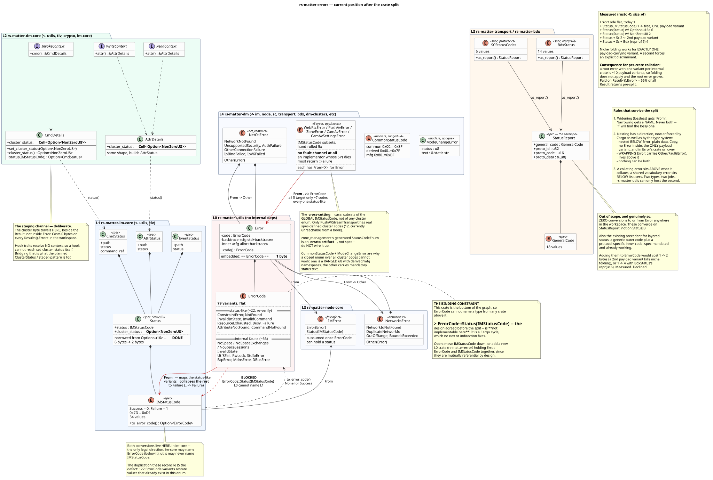
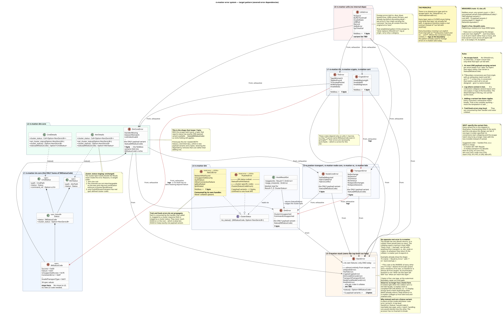

# Addressing issue [#192](https://github.com/project-chip/rs-matter/issues/192) - `ErrorCode` variants

This document describes the intended end goal for this work and the process of
getting there. Getting to the end goal will require a number of incremental PRs,
hence, if the work stops half way, this document shall help any future implementer
to finish this work.

Firstly, the current error systems relies on having one global errors used across
the system, mainly `ErrorCode` and `IMStatusCode` (see image below). While this is
cheap to implement it pollutes APIs and makes it difficult to distinguish errors.



Our target error system defines at least one error type per crate with clear boundaries
and explicit conversions between errors. Below is the final proposed design.



---

# Migration order

The per-crate process is:

1. Pick the next crate in the order below.
2. Create a crate-wide error type with the entries that crate needs — renaming
   where the current name is poor, splitting where one variant absorbs several
   distinguishable failures, adding what is missing.
3. `impl From<NewCrateError> for Error` **in the new crate**.
4. Replace internal uses of `Error`/`ErrorCode` with `NewCrateError`, including
   function signatures.
5. Fix dependents that break.
6. Test, PR.
7. Repeat.
8. When every crate is done, delete `Error` and `ErrorCode` from `rs-matter-utils`.

**TODO**: Once this work is complete, replace this documentation with descriptions of
the latest design, usages and conventions for future work to follow.


## Why this order

It is the **topological order of the crate graph**, cheapest-ready-first within
each tier. That is not an aesthetic preference — it is what avoids throwaway work.

Convert a crate *before* its dependencies and its internals still receive the
shared `Error` from below, so it needs `impl From<Error> for NewCrateError`: a
collapse of all ~79 `ErrorCode` variants onto that crate's set. Lossy, large, and
deleted later.

Convert in dependency order and every incoming conversion is from a crate that has
**already** been converted, so it is small, exhaustive, and **the conversion the
final design keeps**. No shim is thrown away.

Two consequences worth stating:

- **`rs-matter-utils` goes first.** It has no internal dependencies, so
  it is the only crate needing no incoming conversion at all. `Error` and
  `ErrorCode` stay in `utils` alongside its new error types until step 8 — everything
  above keeps compiling against them until its own turn comes.
- **Step 5 is cheaper than the dependent count suggests.** With
  `From<NewCrateError> for Error` in place, a dependent doing `foo()?` into its own
  `Result<_, Error>` still compiles. Only sites that *name* the error type break —
  explicit annotations, `match` arms, errors stored in a field.

## The order

`macros` and `codegen` are **not** separate steps, despite having no dependencies
of their own. They emit code into other crates, so each is merged into the step for
the crate whose signatures its templates must satisfy — see Special cases below.

| # | crate / unit | distinct vars | `ErrorCode` mentions | `pub fn` | `pub(crate) fn` | notes |
|---|---|---|---|---|---|---|
| 1 | `utils` | 13 | 34 | 35 | 0 | no incoming conversion — the only such crate |
| 2 | **`tlv` + `macros`** *(Unit A)* | 5 | 77 | 67 | 1 | **+ the `ToTLV`/`FromTLV` trait signatures** |
| 3 | `crypto` | 4 | 37 | 7 | 0 |  |
| 4 | `pairing` | 4 | 30 | 10 | 0 |  |
| 5 | `cert` | 16 | 98 | 36 | 0 |  |
| 6 | `im-core` | 24 | 59 | 140 | 0 | widest boundary; `Status(IMStatusCode)` becomes available |
| 7 | **`dm-core` + `codegen`** *(Unit B)* | 12 | 49 | 30 | 0 | **`dm-clusters` recompiles as the check** |
| 8 | `node-core` | 21 | 74 | 67 | 0 |  |
| 9 | `transport` | 21 | 167 | 116 | 19 |  |
| 10 | `bdx` | 4 | 8 | 22 | 7 |  |
| 11 | `sc` | 13 | 62 | 42 | 0 |  |
| 12 | `node` | 6 | 9 | 18 | 0 |  |
| 13 | `onboard` | 6 | 16 | 8 | 4 |  |
| 14 | `im` | 7 | 23 | 19 | 7 |  |
| 15 | `respond` | 0 | 0 | 4 | 0 | free — no `ErrorCode` usage |
| 16 | `dm` | 31 | 624 | 58 | 4 | largest single step; only 2 dependents |
| 17 | `stack` | 1 | 2 | 12 | 0 | **`StackError` is built here** — the collator |
| 18 | `rs-matter` | 0 | 0 | 0 | 0 | free — re-exports `StackError` |

`pub fn` and `pub(crate) fn` count functions returning `Result<_, Error>`; those are
the signatures step 4 changes. Comments and `#[cfg(test)]` items are excluded
throughout. Unit rows sum their members and de-duplicate the variant set.

## Special cases

**Zero-work crates — only two.** `respond` (a thin dispatcher) and `rs-matter` (a
121-line facade) have no `ErrorCode` usage. Skip them in steps 2–4.

`dm-clusters` is *not* free, despite showing zero mentions: its source is generated,
and the generated output carries `ErrorCode` paths via `codegen`'s 25 template
mentions. The work is in the generator.

**The two generators must move with the crates they emit into.** `macros` and
`codegen` are not ordinary crates — their `ErrorCode` mentions sit inside `quote!`
templates describing code emitted elsewhere. They pair differently:

**Unit A — `macros` + `tlv` + the TLV trait signatures.** `rs-matter-macros` is
depended on by `rs-matter-tlv` alone. Three things must change together or nothing
compiles:

- the trait signatures, `traits.rs:50` `from_tlv(..) -> Result<Self, Error>` and
  `traits.rs:94` `to_tlv(..) -> Result<(), Error>`
- the macro templates, which emit *against* those signatures — e.g.
  `nullable_to_tlv` currently writes both the return type
  `Result<(), #krate::__private::Error>` and the body
  `Err(#krate::__private::ErrorCode::ConstraintError.into())`
- `tlv`'s own internals

Once the signature is `Result<(), TlvError>` the template body becomes
`Err(TlvError::ConstraintError)` — the `.into()` disappears.

**Unit B — `codegen` + `dm-core` + `dm-clusters`.** `rs-matter-codegen` is depended
on by `rs-matter-dm-clusters` alone, and is run from its `build.rs` into `OUT_DIR`.
Its templates emit cluster *handler* impls, so the error type they must name is
fixed by `dm-core`'s handler trait signatures — not by TLV. These three sit at
positions 9–10 in the order, already adjacent.

**The derive ripple is one impl, not thirteen.** Changing the TLV trait error type
touches derive-generated code in 13 crates — `im-core` (9 derive files, 40 call
sites), `dm` (16/20), `tlv` (4/31), `sc` (4/11), `codegen` (2/13), `dm-core` (2/6),
`im` (1/8), `node-core` (5/4) and five more. But every unconverted consumer still
returns `Error`, so a single `impl From<TlvError> for Error` in `tlv` keeps all of
them compiling through `?`. Each consumer gets its own conversion later, on its own
turn. The same holds for unit B.

**`im-core` has the widest boundary**: 140 `pub fn` returning `Result<_, Error>`,
against 59 mentions and 24 distinct variants. The vocabulary is modest; the
signature churn is not. It is also the home of `IMStatusCode`, so this is where
`Status(IMStatusCode)` first becomes available as a payload variant.

**`dm` is the largest single step**: 624 mentions, 31 distinct variants, 62
signatures — but only 2 dependents (`rs-matter`, `stack`), so it ripples almost
nowhere. It lands at #19 because it depends on nearly everything.

## Naming and conversion convention

Variant *names* are crate-local and constrain nobody: the only cross-crate
obligations are the `From` impls and, where relevant, the conversion to
`IMStatusCode`. Nothing `dm` calls its variants affects what `cert` or `tlv` call
theirs, and there is no failure mode available to `dm` that is not also available
to `crypto` — it is simply larger.

What *can* drift is **collapse granularity**. A conversion may legitimately map
several source variants onto one target, logging at the boundary. But if
`node-core` collapses `TlvError`'s five variants into one while `transport` keeps
them distinct, the same underlying failure reaches the top with different detail
depending on the route it took. That is not a correctness problem — the boundary
log preserves the detail either way — but it is the kind of inconsistency that gets
re-litigated in every PR unless a rule is agreed first.

The rule is: **collapse at the layer where the distinction stops being
actionable.** If a caller could plausibly branch on the difference, keep it; if no
caller could, collapse it and log.

---

# Appendix A - ErrorCode / IMStatusCode usage by crate (production code only)

Generated from source. Counts qualified-path mentions (`ErrorCode::X`, `IMStatusCode::X`) in each crate's `src/`, with **line comments and every `#[cfg(test)]` item removed**, and the `tests/` and `examples/` workspace members excluded. Blank cells are zero.

Rows are sorted by **number of crates** that use the variant, then by total mentions — so the variants at the top are the ones hardest to confine to a single layer, and those at the bottom are the easiest.

Caveat: `codegen` and `macros` mentions are inside `quote!` templates. They describe code emitted into the generated cluster handlers, not those crates' own error handling.

## ErrorCode (79 variants)

| variant | bdx | cert | codegen | crypto | dm | dm-core | im | im-core | macros | node | node-core | onboard | pairing | sc | stack | tlv | transport | utils | TOT | crates |
|---|---|---|---|---|---|---|---|---|---|---|---|---|---|---|---|---|---|---|---|---|
| `InvalidData` |  | 36 | 4 | 31 | 31 |  |  | 3 |  | 1 | 6 | 4 | 20 | 15 |  | 16 | 22 | 3 | **192** | 13 |
| `Invalid` | 4 | 17 |  |  | 23 | 1 | 5 | 8 | 3 |  | 4 |  |  | 22 |  | 5 | 30 | 3 | **125** | 12 |
| `BufferTooSmall` |  | 4 |  | 3 | 2 | 2 |  |  |  | 2 | 5 | 2 | 7 | 2 |  |  | 3 | 4 | **36** | 11 |
| `ConstraintError` |  |  |  | 2 | 266 | 4 | 1 | 2 | 3 |  | 6 |  |  | 1 |  | 17 |  |  | **302** | 9 |
| `NotFound` |  | 6 |  |  | 38 |  |  | 2 |  |  | 8 | 1 | 2 | 2 |  | 1 | 5 |  | **65** | 9 |
| `InvalidAction` |  |  | 1 |  | 43 | 1 | 5 | 2 |  |  | 3 |  |  |  | 2 |  |  |  | **57** | 7 |
| `Failure` |  |  | 1 |  | 17 |  |  | 7 |  |  | 1 | 6 |  |  |  |  | 3 |  | **35** | 6 |
| `NoSpace` |  |  |  | 1 | 9 |  | 7 |  |  |  |  |  | 1 |  |  |  | 4 | 6 | **28** | 6 |
| `Busy` |  |  |  |  | 2 |  |  | 2 |  | 1 | 2 | 1 |  | 2 |  |  |  |  | **10** | 6 |
| `ResourceExhausted` |  |  |  |  | 47 |  | 2 | 2 |  |  | 17 |  |  |  |  |  | 9 |  | **77** | 5 |
| `InvalidCommand` |  |  |  |  | 43 |  |  | 2 |  |  | 4 |  |  | 2 |  |  |  |  | **51** | 4 |
| `AttributeNotFound` |  |  | 11 |  | 26 | 4 |  | 2 |  |  |  |  |  |  |  |  |  |  | **43** | 4 |
| `CommandNotFound` |  |  | 6 |  | 24 | 3 |  | 2 |  |  |  |  |  |  |  |  |  |  | **35** | 4 |
| `NoSession` |  |  |  |  |  |  |  |  |  | 1 |  | 2 |  | 4 |  |  | 14 |  | **21** | 4 |
| `InvalidState` |  |  |  |  | 4 |  |  |  |  |  | 1 |  |  | 1 |  |  | 10 |  | **16** | 4 |
| `InvalidOpcode` | 1 |  |  |  |  |  | 1 |  |  |  |  |  |  | 7 |  |  | 5 |  | **14** | 4 |
| `FailSafeRequired` |  |  |  |  | 1 |  |  | 2 |  | 1 | 2 |  |  |  |  |  |  |  | **6** | 4 |
| `NoNetworkInterface` |  |  |  |  | 6 |  |  |  |  |  |  |  |  | 1 |  |  | 20 |  | **27** | 3 |
| `UnsupportedAccess` |  |  |  |  | 14 |  |  | 2 |  |  | 1 |  |  |  |  |  |  |  | **17** | 3 |
| `EndpointNotFound` |  |  |  |  | 2 | 6 |  | 2 |  |  |  |  |  |  |  |  |  |  | **10** | 3 |
| `EventNotFound` |  |  | 2 |  |  | 1 |  | 2 |  |  |  |  |  |  |  |  |  |  | **5** | 3 |
| `InvalidProto` | 1 |  |  |  |  |  | 2 |  |  |  |  |  |  | 2 |  |  |  |  | **5** | 3 |
| `TLVTypeMismatch` |  |  |  |  |  |  |  |  | 2 |  |  |  |  |  |  | 30 |  |  | **32** | 2 |
| `TxTimeout` |  |  |  |  |  |  |  |  |  |  |  |  |  |  |  |  | 12 | 1 | **13** | 2 |
| `InvalidInState` |  |  |  |  | 7 |  |  | 2 |  |  |  |  |  |  |  |  |  |  | **9** | 2 |
| `GennCommInvalidAuthentication` |  |  |  |  | 3 |  |  |  |  |  | 4 |  |  |  |  |  |  |  | **7** | 2 |
| `BtpError` |  |  |  |  |  |  |  |  |  |  |  |  |  |  |  |  | 4 | 2 | **6** | 2 |
| `TruncatedPacket` | 2 |  |  |  |  |  |  |  |  |  |  |  |  |  |  |  |  | 3 | **5** | 2 |
| `InvalidDataType` |  |  |  |  | 2 |  |  | 2 |  |  |  |  |  |  |  |  |  |  | **4** | 2 |
| `InvalidSignature` |  | 2 |  |  |  |  |  |  |  |  |  |  |  |  |  |  | 2 |  | **4** | 2 |
| `NocInvalidFabricIndex` |  |  |  |  | 3 |  |  |  |  |  | 1 |  |  |  |  |  |  |  | **4** | 2 |
| `ClusterNotFound` |  |  |  |  |  | 1 |  | 2 |  |  |  |  |  |  |  |  |  |  | **3** | 2 |
| `DataVersionMismatch` |  |  |  |  |  | 1 |  | 2 |  |  |  |  |  |  |  |  |  |  | **3** | 2 |
| `DynamicConstraintError` |  |  |  |  | 1 |  |  | 2 |  |  |  |  |  |  |  |  |  |  | **3** | 2 |
| `NocFabricConflict` |  |  |  |  | 1 |  |  |  |  |  | 2 |  |  |  |  |  |  |  | **3** | 2 |
| `NocInvalidNoc` |  |  |  |  | 1 |  |  |  |  |  | 2 |  |  |  |  |  |  |  | **3** | 2 |
| `NocInvalidPublicKey` |  |  |  |  | 1 |  |  |  |  |  | 2 |  |  |  |  |  |  |  | **3** | 2 |
| `StdIoError` |  | 1 |  |  |  |  |  |  |  |  |  |  |  |  |  |  |  | 2 | **3** | 2 |
| `AlreadyExists` |  |  |  |  | 1 |  |  | 1 |  |  |  |  |  |  |  |  |  |  | **2** | 2 |
| `NocFabricTableFull` |  |  |  |  | 1 |  |  |  |  |  | 1 |  |  |  |  |  |  |  | **2** | 2 |
| `NocInvalidAdminSubject` |  |  |  |  | 1 |  |  |  |  |  | 1 |  |  |  |  |  |  |  | **2** | 2 |
| `NocMissingCsr` |  |  |  |  | 1 |  |  |  |  |  | 1 |  |  |  |  |  |  |  | **2** | 2 |
| `RxTimeout` |  |  |  |  |  |  |  |  |  |  |  |  |  |  |  |  | 1 | 1 | **2** | 2 |
| `CdInvalidFormat` |  | 12 |  |  |  |  |  |  |  |  |  |  |  |  |  |  |  |  | **12** | 1 |
| `DBusError` |  |  |  |  |  |  |  |  |  |  |  |  |  |  |  |  |  | 6 | **6** | 1 |
| `NoSpaceSessions` |  |  |  |  |  |  |  |  |  |  |  |  |  |  |  |  | 6 |  | **6** | 1 |
| `CdInvalidProductId` |  | 5 |  |  |  |  |  |  |  |  |  |  |  |  |  |  |  |  | **5** | 1 |
| `CdInvalidVendorId` |  | 5 |  |  |  |  |  |  |  |  |  |  |  |  |  |  |  |  | **5** | 1 |
| `Duplicate` |  |  |  |  |  |  |  |  |  |  |  |  |  |  |  |  | 5 |  | **5** | 1 |
| `MdnsError` |  |  |  |  |  |  |  |  |  |  |  |  |  |  |  |  | 5 |  | **5** | 1 |
| `CdSigningKeyNotFound` |  | 3 |  |  |  |  |  |  |  |  |  |  |  |  |  |  |  |  | **3** | 1 |
| `NoExchange` |  |  |  |  |  |  |  |  |  |  |  |  |  |  |  |  | 3 |  | **3** | 1 |
| `NoMemory` |  |  |  |  |  |  |  |  |  | 3 |  |  |  |  |  |  |  |  | **3** | 1 |
| `NoSpaceExchanges` |  |  |  |  |  |  |  |  |  |  |  |  |  |  |  |  | 3 |  | **3** | 1 |
| `InvalidTime` |  | 2 |  |  |  |  |  |  |  |  |  |  |  |  |  |  |  |  | **2** | 1 |
| `InvalidTransportType` |  |  |  |  |  |  |  | 2 |  |  |  |  |  |  |  |  |  |  | **2** | 1 |
| `NeedsTimedInteraction` |  |  |  |  |  |  |  | 2 |  |  |  |  |  |  |  |  |  |  | **2** | 1 |
| `NocLabelConflict` |  |  |  |  | 2 |  |  |  |  |  |  |  |  |  |  |  |  |  | **2** | 1 |
| `NodeNotFound` |  |  |  |  |  |  |  | 2 |  |  |  |  |  |  |  |  |  |  | **2** | 1 |
| `CdInvalidPaa` |  | 1 |  |  |  |  |  |  |  |  |  |  |  |  |  |  |  |  | **1** | 1 |
| `CdInvalidSignature` |  | 1 |  |  |  |  |  |  |  |  |  |  |  |  |  |  |  |  | **1** | 1 |
| `InvalidArgument` |  |  |  |  |  |  |  |  |  |  |  |  |  |  |  |  | 1 |  | **1** | 1 |
| `InvalidAuthKey` |  | 1 |  |  |  |  |  |  |  |  |  |  |  |  |  |  |  |  | **1** | 1 |
| `NoFabricId` |  | 1 |  |  |  |  |  |  |  |  |  |  |  |  |  |  |  |  | **1** | 1 |
| `NoNodeId` |  | 1 |  |  |  |  |  |  |  |  |  |  |  |  |  |  |  |  | **1** | 1 |
| `NoSharedTrustRoots` |  |  |  |  |  |  |  |  |  |  |  |  |  | 1 |  |  |  |  | **1** | 1 |
| `RwLock` |  |  |  |  |  |  |  |  |  |  |  |  |  |  |  |  |  | 1 | **1** | 1 |
| `SysTimeFail` |  |  |  |  |  |  |  |  |  |  |  |  |  |  |  |  |  | 1 | **1** | 1 |
| `Utf8Fail` |  |  |  |  |  |  |  |  |  |  |  |  |  |  |  |  |  | 1 | **1** | 1 |
| `AttributeIsCustom` |  |  |  |  |  |  |  |  |  |  |  |  |  |  |  |  |  |  | **0** |  |
| `InvalidAAD` |  |  |  |  |  |  |  |  |  |  |  |  |  |  |  |  |  |  | **0** |  |
| `InvalidKeyLength` |  |  |  |  |  |  |  |  |  |  |  |  |  |  |  |  |  |  | **0** |  |
| `InvalidPeerAddr` |  |  |  |  |  |  |  |  |  |  |  |  |  |  |  |  |  |  | **0** |  |
| `NoCommand` |  |  |  |  |  |  |  |  |  |  |  |  |  |  |  |  |  |  | **0** |  |
| `NoEndpoint` |  |  |  |  |  |  |  |  |  |  |  |  |  |  |  |  |  |  | **0** |  |
| `NoHandler` |  |  |  |  |  |  |  |  |  |  |  |  |  |  |  |  |  |  | **0** |  |
| `NoTagFound` |  |  |  |  |  |  |  |  |  |  |  |  |  |  |  |  |  |  | **0** |  |
| `PacketPoolExhaust` |  |  |  |  |  |  |  |  |  |  |  |  |  |  |  |  |  |  | **0** |  |
| `TLVNotFound` |  |  |  |  |  |  |  |  |  |  |  |  |  |  |  |  |  |  | **0** |  |
| **TOTAL** | **8** | **98** | **25** | **37** | **623** | **24** | **23** | **59** | **8** | **9** | **74** | **16** | **30** | **62** | **2** | **69** | **167** | **34** | | |

### Unused in production code (10)

Candidates for deletion — referenced only in tests, comments, or not at all.

`AttributeIsCustom`, `InvalidAAD`, `InvalidKeyLength`, `InvalidPeerAddr`, `NoCommand`, `NoEndpoint`, `NoHandler`, `NoTagFound`, `PacketPoolExhaust`, `TLVNotFound`

## IMStatusCode (35 variants)

| variant | dm | dm-core | im | im-core | transport | TOT | crates |
|---|---|---|---|---|---|---|---|
| `Success` | 5 |  | 5 | 4 | 7 | **21** | 4 |
| `UnsupportedAccess` | 1 | 2 | 4 | 1 |  | **8** | 4 |
| `UnsupportedAttribute` |  | 2 | 3 | 1 |  | **6** | 3 |
| `UnsupportedCluster` |  | 2 | 3 | 1 |  | **6** | 3 |
| `UnsupportedEndpoint` |  | 2 | 2 | 1 |  | **5** | 3 |
| `Failure` |  |  | 1 | 2 | 1 | **4** | 3 |
| `UnsupportedCommand` |  | 2 | 1 | 1 |  | **4** | 3 |
| `ResourceExhausted` | 1 |  | 1 | 1 |  | **3** | 3 |
| `InvalidAction` |  |  | 5 | 1 |  | **6** | 2 |
| `ConstraintError` | 3 |  |  | 1 |  | **4** | 2 |
| `Busy` |  |  | 2 | 1 |  | **3** | 2 |
| `NeedsTimedInteraction` |  |  | 2 | 1 |  | **3** | 2 |
| `NotFound` | 2 |  |  | 1 |  | **3** | 2 |
| `UnsupportedEvent` |  |  | 2 | 1 |  | **3** | 2 |
| `UnsupportedNode` |  |  | 2 | 1 |  | **3** | 2 |
| `UnsupportedRead` |  | 2 | 1 |  |  | **3** | 2 |
| `UnsupportedWrite` |  | 2 | 1 |  |  | **3** | 2 |
| `DataVersionMismatch` |  | 1 |  | 1 |  | **2** | 2 |
| `AlreadyExists` |  |  |  | 1 |  | **1** | 1 |
| `DynamicConstraintError` |  |  |  | 1 |  | **1** | 1 |
| `FailSafeRequired` |  |  |  | 1 |  | **1** | 1 |
| `InvalidCommand` |  |  |  | 1 |  | **1** | 1 |
| `InvalidDataType` |  |  |  | 1 |  | **1** | 1 |
| `InvalidInState` |  |  |  | 1 |  | **1** | 1 |
| `InvalidSubscription` |  |  | 1 |  |  | **1** | 1 |
| `InvalidTransportType` |  |  |  | 1 |  | **1** | 1 |
| `TimedRequestMisMatch` |  |  | 1 |  |  | **1** | 1 |
| `Timeout` |  |  | 1 |  |  | **1** | 1 |
| `AccessRestricted` |  |  |  |  |  | **0** |  |
| `MaintenanceRequired` |  |  |  |  |  | **0** |  |
| `NoCommandResponse` |  |  |  |  |  | **0** |  |
| `NoUpstreamSubscription` |  |  |  |  |  | **0** |  |
| `PathsExhausted` |  |  |  |  |  | **0** |  |
| `TermsAndConditionsChanged` |  |  |  |  |  | **0** |  |
| `UnreportableAttribute` |  |  |  |  |  | **0** |  |
| **TOTAL** | **12** | **15** | **38** | **27** | **8** | | |

### Unused in production code (7)

Spec-defined, so deletion is not an option — but nothing emits these today.

`AccessRestricted`, `MaintenanceRequired`, `NoCommandResponse`, `NoUpstreamSubscription`, `PathsExhausted`, `TermsAndConditionsChanged`, `UnreportableAttribute`

# Appendix B - Error conversion records

## `rs-matter-utils`

13 variants become 5, split across **two** error types rather than one crate-wide
enum. The governing rule for keeping a variant: some function **in this crate** must
be able to produce it. Everything else was present solely because a
`From<ForeignError> for Error` impl lived here for the convenience of crates above.

The split follows the usage boundary. `BufferError` covers `storage::WriteBuf` and
`storage::ReadBuf` — two halves of one abstraction, used together on the same byte
stream by nearly every crate. `Base38Error` covers the base38 codec, which is
independent of the buffers and has a single consumer, `rs-matter-pairing`.
Separating it also allows more precise names than a shared enum could carry: the
old `InvalidData` becomes `InvalidCharacter` and `InvalidLength`.

Because that one consumer is so contained, `Base38Error` needs **no bridge at all**.
`qr.rs` converts it explicitly where it decodes the payload body. `BufferError`
still has one, since `storage` is used by nearly every crate.

| Current `ErrorCode` | usages | New code | Note |
|---|---|---|---|
| NoSpace | 6 | `BufferErrorCode::BufferTooSmall` | Merged. All 6 are `WriteBuf` (`load`, `reserve`, `shrink`, `expand`, `prepend_with`, `append_with`) and are the same event as the existing `BufferTooSmall` sites: a fixed-capacity buffer could not take the data. The "TLV writer ran out of room, so chunk" reading belongs to `TlvError`, which `rs-matter-tlv` derives from this variant. |
| BufferTooSmall | 4 | `BufferErrorCode::BufferTooSmall` / `Base38ErrorCode::OutputTooSmall` | Split by owner. `ReadBuf::load` and `write_split!` are buffer failures; base38's two sites are the caller's output `String`/`Vec` refusing the result, hence the clearer name. |
| TruncatedPacket | 3 | `BufferErrorCode::UnexpectedEof` | Renamed. `ReadBuf` is a generic byte reader; "packet" is a transport word that leaked down. |
| InvalidData | 3 | `Base38ErrorCode::InvalidCharacter` / `InvalidLength` | Split. base38 is the only producer: two sites reject a byte outside the alphabet, one rejects a chunk whose length cannot encode whole bytes. |
| Invalid | 3 | *removed* | `WriteBuf::reserve`'s "buffer not pristine" is caller misuse → `debug_assert!`, no variant. The `From<TryFromSliceError>` and `From<TryFromPrimitiveError>` cases leave with their impls (see below). |
| DBusError | 6 | *removed* | No producer here. The `zbus_proxies` tree stays in this crate, but the proxies return `zbus::Result` and no utils signature ever mentions this code. Needed by `transport` (mDNS, BlueZ) and `dm` (NetworkManager, wpa_supplicant). |
| BtpError | 2 | *removed* | No producer here. Only reachable via `From<bluer::Error>`, whose sole consumer is the BTP backend in `transport`. |
| StdIoError | 2 | *removed* | No producer here. Needed by `transport`, `cert`, `dm`, `node`. |
| TxTimeout | 1 | *removed* | No producer here — every producer is in `transport`. Present only because `Error::is_peer_unresponsive()` lives here; that method moves to `TransportError` too. |
| RxTimeout | 1 | *removed* | As `TxTimeout`. |
| RwLock | 1 | *removed* | No producer here, and **no producer anywhere in the workspace** — every `.lock()` is either async or `.unwrap()`ed in a test. Add it to a crate error only when a real `?` site appears. |
| SysTimeFail | 1 | *removed* | As `RwLock` — no in-tree producer at all. |
| Utf8Fail | 1 | *removed* | No producer here. Reachable only via `From<Utf8Error>`; nothing in the workspace matches on it. |

Resulting types, both wrapped as `Error2<_>` (`BufferError`, `Base38Error`), each
with a bridge to the legacy `Error`:

```rust
pub enum BufferErrorCode {
    /// A fixed-capacity buffer could not accept the data.
    BufferTooSmall,
    /// A read ran past the end of the input.
    UnexpectedEof,
}

pub enum Base38ErrorCode {
    /// A character outside the base38 alphabet was encountered while decoding.
    InvalidCharacter,
    /// A base38 chunk had a length that cannot encode a whole number of bytes.
    InvalidLength,
    /// The caller-supplied output container could not fit the result.
    OutputTooSmall,
}
```

`WriteBuf` alone would have yielded a one-variant error type, so it shares
`BufferError` with `ReadBuf` instead; the read/write distinction that matters is
already carried by `BufferTooSmall` (destination undersized) versus
`UnexpectedEof` (source exhausted).

### Supporting changes

- `Error2<T>` — the generic replacement for `Error`, parameterised over the code
  type — `BufferError = Error2<BufferErrorCode>`, and so on. Renamed to `Error` once the legacy
  type is deleted.
- `MatterError` — a blanket-implemented marker trait collecting the bounds a code
  type must satisfy (`Copy + Debug`, plus `defmt::Format` under the `defmt`
  feature), so the six `Error2` impls carry one bound instead of a repeated list.
- `WriteBuf` and `ReadBuf` now return `BufferError`, and base38 returns
  `Base38Error`. Only `BufferError` carries a `From<_> for Error` bridge, to keep
  the many unconverted `storage` callers compiling; it goes when they are converted.
  `Base38Error` has no bridge — its sole consumer converts at the call site, which
  is already the final shape.

Two things in this crate deliberately still name the legacy `Error`, because
converting them breaks a dependent that has not had its turn yet:

- `WriteBuf::append_with_buf` takes a caller-supplied callback that fills a byte
  slice. That callback can fail for reasons utils knows nothing about, so the right signature is a free generic `E` with no bound, since the method only propagates the callback's error and never produces one of its own. Pinning it to `BufferError`
  would force `sc` and `dm` to funnel foreign errors through a utils variant.
- The `write_split!` macro raises `BufferErrorCode::BufferTooSmall`, but widens the
  result to the legacy `Error` via the bridge so that its callers, all in
  `transport`'s mDNS code, keep compiling. Once `transport` is converted the macro
  returns `BufferError` and those callers convert it explicitly.

## `rs-matter-tlv` and `rs-matter-macros`

One error type covers both crates: `TlvError`, with the codes below.
`rs-matter-macros` needs none of its own - it only generates code that lands in
other crates, and that code names tlv's type.

### The new codes

| Code | Means |
|---|---|
| `Malformed` | The bytes are not valid TLV. A bad control byte, a value shorter than its declared type needs, a UTF-8 string that is not valid UTF-8. |
| `TypeMismatch` | The element is fine, but it is not the type the caller asked for - reading a `u8` from an element holding a string. |
| `NotFound` | A required element or context tag is missing. |
| `InvalidValue` | Right type, unacceptable value - an unknown enum discriminant, or zero where a `NonZero` was expected. |
| `CapacityExceeded` | The decoded data did not fit in the destination - too many array items, a string longer than the buffer. |
| `UnexpectedNull` | The value is the reserved "null" marker somewhere null is not allowed. |
| `NoSpace` | The TLV writer ran out of room. The interaction model watches for this one to decide that a long response must be split into chunks. |

The old codes did not line up one-to-one with these, which is the reason for the
split. `TLVTypeMismatch` alone was doing three unrelated jobs: wrong type, bad
bytes, and missing element. `ConstraintError` covered both "the buffer is full"
and "this value is the null marker". `Invalid` covered a wrong type and an
out-of-range value.

### Progress

This is being done in several steps, because changing a TLV trait forces every
implementor of it to change at the same time, across many crates. One trait per
step keeps each change reviewable.

**Step 1 - the reader methods.** The plain accessors on `TLVElement` (`u8`,
`utf8`, `str`, `tag`, and friends) and `TLVControl::parse` report `TlvError`.

| Old code | Sites | New code |
|---|---|---|
| `TLVTypeMismatch` | 55 | `Malformed` where the bytes are bad, `TypeMismatch` where the type is wrong |
| `InvalidData` | 14 | `Malformed` - a value whose length contradicts its declared type |
| `Invalid` | 3 | `TypeMismatch` - asking for a string from a non-string element |
| `NotFound` | 1 | `NotFound` |

**Step 2a - the `FromTLV` trait** (this branch). `from_tlv`, `init_from_tlv`,
`nullable_from_tlv` and `init_nullable_from_tlv` now report `TlvError`, together
with every implementation of them: 55 methods, the `#[derive(FromTLV)]` templates
in `rs-matter-macros`, and the generated cluster structs from `rs-matter-codegen`.
The iterating reader methods (`find_ctx`, `ctx`, `read`, `read_opt`) moved with
them, since they call `FromTLV`.

New codes used by the converted implementations:

| New code | Where |
|---|---|
| `InvalidValue` | An unknown enum discriminant or bitflag - `AuthMode`, `Privilege`, `IMStatusCode`, `DNTag`, `EventDataTag`, and the derived enums |
| `CapacityExceeded` | A `Vec`, `String` or array that could not hold the decoded value |
| `UnexpectedNull` | The null marker read into a type that does not allow null |
| `NotFound` | A mandatory field absent from a struct - the `EventData` fields |
| `TypeMismatch` | A tag that is not a context tag |

`ToTLV` still reports the shared `Error`, so the two traits disagree for now.
That is deliberate: it is what keeps this step to one trait.

### Converting a dependent crate

Crates that are not yet converted keep reporting the shared `Error`. Where they
call TLV, the two meet, and the conversion goes at that boundary rather than
spreading `TlvError` into the crate:

- A tail call becomes `Ok(expr?)`, or `.map_err(Into::into)` where `?` does not fit.
- If a helper is called many times, change its parameter instead of every call.
  `AudioAvStreamHandler::validate` takes `Result<T, TlvError>` and returns
  `Result<T, Error>`, which fixed six call sites at once.
- If a crate error already wraps `Error`, give it `From<TlvError>` and `?` keeps
  working untouched - see `NetworksError` in `rs-matter-node-core`.

These conversions are temporary. They disappear when the crate gets its own
error type, so they are marked with a TODO where they are not obvious.

**Still to do:** `ToTLV`, `TLVWrite` and `TLVBuilder`, one at a time; the
`ConstraintError` and `NoSpace` sites that live in those implementations; and
`TLVWrite::str_cb` / `utf8_cb`, whose callbacks should stay generic over the
caller's error (see above).
